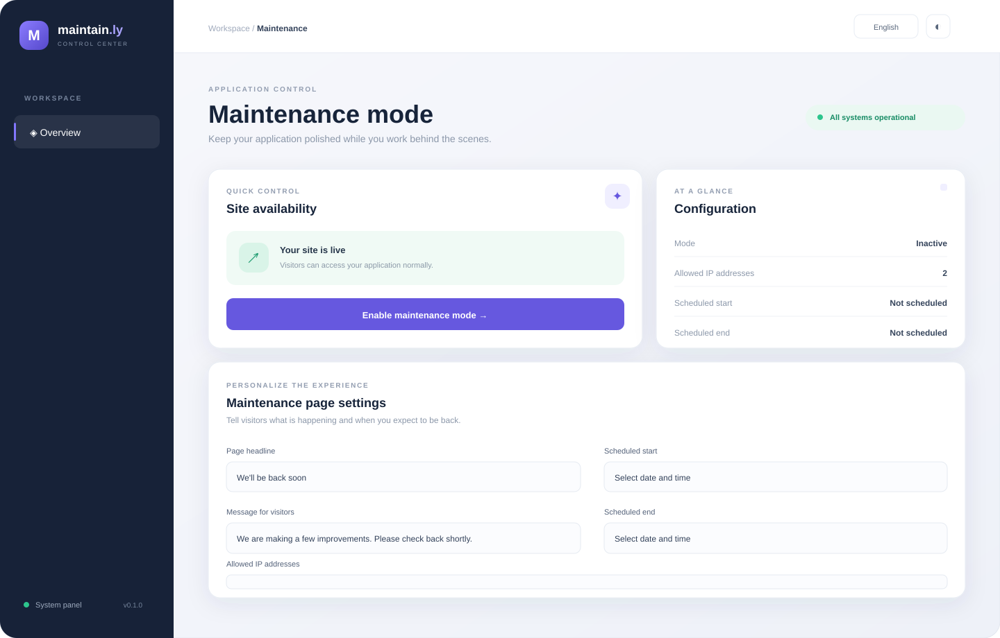

# Laravel Maintenance Manager

[](https://github.com/mertaydin/laravel-maintenance-manager/actions/workflows/tests.yml)
[](https://packagist.org/packages/mertaydin/laravel-maintenance-manager)
[](https://packagist.org/packages/mertaydin/laravel-maintenance-manager)
[](https://packagist.org/packages/mertaydin/laravel-maintenance-manager)
[](https://packagist.org/packages/mertaydin/laravel-maintenance-manager)
[](LICENSE)

A responsive maintenance-mode control panel for Laravel.

## Dashboard authorization

The management dashboard is protected by Laravel's `web` and `auth` middleware by default. Both the dashboard page and its update endpoint require an authenticated user. You can customize the route middleware in the published `config/maintenance-manager.php` file:

```php
'route' => [
    'prefix' => env('MAINTENANCE_MANAGER_ROUTE_PREFIX', 'maintenance-manager'),
    'middleware' => ['web', 'auth'],
],
```

Add an admin/role middleware here when only privileged users should manage maintenance mode.

## Dashboard preview

<p align="center">
  
</p>
 Enable or schedule downtime, customize the visitor page with an optional image, manage IP allowlists, review recent mode changes, and grant temporary bypass access with a private secret.

## Requirements

- PHP 8.2+
- Laravel 10, 11, 12 or 13

## Installation

```bash
composer require mertaydin/laravel-maintenance-manager
php artisan vendor:publish --tag=maintenance-manager-config
php artisan vendor:publish --tag=maintenance-manager-assets
```

The dashboard is available at `/maintenance-manager`. By default, its routes use Laravel's `web` and `auth` middleware. Change `route.middleware` in `config/maintenance-manager.php` if your application uses a different authentication or authorization middleware. Protect this route with an administrator-only policy or middleware in production.

## Enable request interception

The package deliberately does not register its maintenance middleware globally. Add it to your application's web middleware group so normal application requests are intercepted.

### Laravel 11, 12 and 13

In `bootstrap/app.php`:

```php
use Illuminate\Foundation\Configuration\Middleware;
use MertAydin\MaintenanceManager\Http\Middleware\MaintenanceMiddleware;

->withMiddleware(function (Middleware $middleware) {
    $middleware->web(append: [
        MaintenanceMiddleware::class,
    ]);
})
```

### Laravel 10

Append `MertAydin\MaintenanceManager\Http\Middleware\MaintenanceMiddleware::class` to the `web` middleware group in `app/Http/Kernel.php`.

The default excluded paths include the dashboard route, Laravel's health endpoint, and common asset paths. Customize `except` in the package config as needed.

## Configuration

Publish the config file and review:

- `enabled`: master switch for the package middleware.
- `route.prefix`: dashboard URL prefix.
- `route.middleware`: middleware protecting the dashboard.
- `allowed_ips`: IP addresses that can access the application during maintenance.
- `except`: URL path patterns excluded from maintenance.
- `storage`: JSON state file path.
- `timezone`: timezone used for scheduled start/end values.
- `bypass_secret`: optional temporary-access secret.

The dashboard includes six languages (Turkish, English, Spanish, Simplified Chinese, Hindi, and Arabic), light/dark/system themes, and optional JPG, PNG, or WebP maintenance artwork (maximum 2 MB). The selected language is also applied to the public maintenance page. Uploaded artwork is stored under `public/vendor/maintenance-manager/uploads`.

The manager stores its state in `storage/app/maintenance-manager.json` by default. Ensure the PHP process can write to that directory.

## Temporary bypass access

Set a long random value in `.env`:

```dotenv
MAINTENANCE_MANAGER_BYPASS_SECRET="replace-with-a-long-random-secret"
```

Open a URL with `?maintenance_bypass=YOUR_SECRET`. The package validates the secret, redirects to the clean URL, and issues an HTTP-only bypass cookie. The cookie lifetime is configurable with `bypass_cookie_minutes`. Keep the secret private and rotate it after the maintenance window.

## Assets and Content Security Policy

The dashboard styles and scripts are served as separate published files under `public/vendor/maintenance-manager`. The package does not require inline JavaScript or inline style attributes.

## License

MIT
