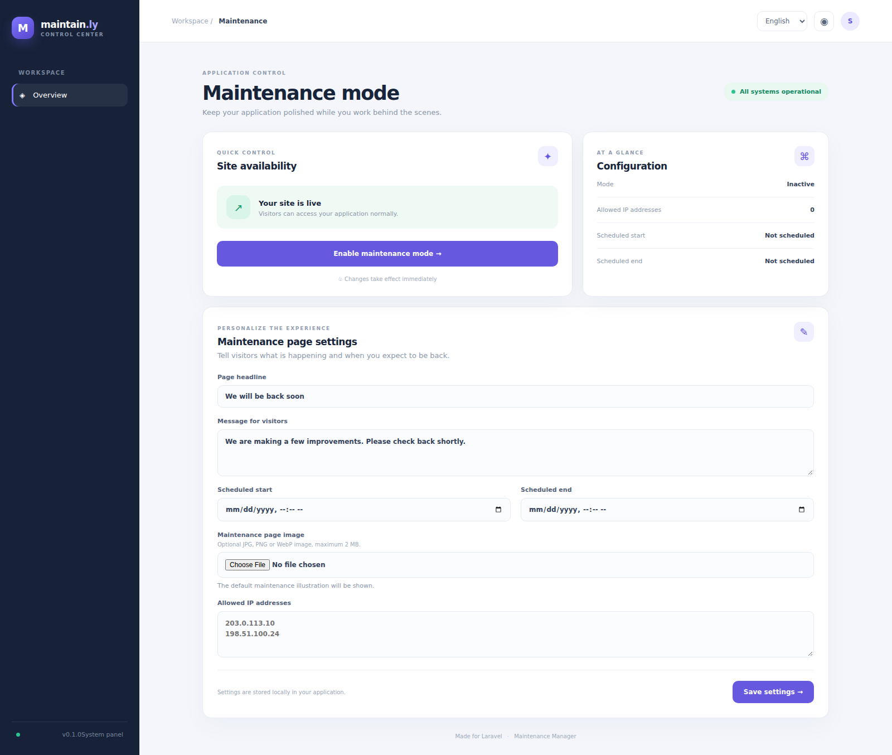

# Laravel Maintenance Manager

[](https://packagist.org/packages/laravel-maintenance-manager)
[](https://packagist.org/packages/laravel-maintenance-manager)
[](https://packagist.org/packages/laravel-maintenance-manager)
[](https://laravel.com)
[](https://github.com/mertaydin/laravel-maintenance-manager/actions/workflows/tests.yml)
[](LICENSE)


Laravel için duyarlı bir bakım modu yönetim paneli.

## Panel yetkilendirmesi

Yönetim paneli varsayılan olarak Laravel'in `web` ve `auth` middleware'leriyle korunur. Hem panel sayfası hem de güncelleme uç noktası kimliği doğrulanmış kullanıcı gerektirir. Yayımlanan `config/maintenance-manager.php` dosyasında rota middleware'lerini özelleştirebilirsiniz:

```php
'route' => [
    'prefix' => env('MAINTENANCE_MANAGER_ROUTE_PREFIX', 'maintenance-manager'),
    'middleware' => ['web', 'auth'],
],
```

Bakım modunu yalnızca yetkili kullanıcıların yönetmesi gerekiyorsa buraya yönetici/rol middleware'i ekleyin.

## Panel önizlemesi

Ekran görüntüsü GitHub Actions (Playwright) tarafından geçici bir Laravel uygulamasında paketin gerçek panelinden otomatik olarak yeniden alınır.

<p align="center">
  
</p>

Kesinti süresini hemen etkinleştirin veya zamanlayın, ziyaretçi sayfasını isteğe bağlı görselle özelleştirin, IP izin listelerini yönetin, son mod değişikliklerini inceleyin ve gizli bir anahtarla geçici bypass erişimi verin.

## Gereksinimler

- PHP 8.2+
- Laravel 10, 11, 12 veya 13

## Kurulum

```bash
composer require mertaydin/laravel-maintenance-manager
php artisan vendor:publish --tag=maintenance-manager-config
php artisan vendor:publish --tag=maintenance-manager-assets --force
```

Her paket güncellemesinden sonra en yeni panel JavaScript ve CSS dosyalarının daha önce yayımlanan kopyaların yerini alması için asset yayımlama komutunu `--force` ile yeniden çalıştırın.

Panel `/maintenance-manager` adresindedir. Rotalar varsayılan olarak Laravel'in `web` ve `auth` middleware'lerini kullanır. Uygulamanız farklı kimlik doğrulama veya yetkilendirme middleware'i kullanıyorsa `config/maintenance-manager.php` içindeki `route.middleware` değerini değiştirin. Üretimde bu rotayı yalnızca yöneticilere izin veren bir policy veya middleware ile koruyun.

## İstek yakalamayı etkinleştirme

Paket bakım middleware'ini bilerek global olarak kaydetmez. Normal uygulama isteklerinin yakalanması için middleware'i uygulamanızın web middleware grubuna ekleyin.

### Laravel 11, 12 ve 13

`bootstrap/app.php` içinde:

```php
use Illuminate\Foundation\Configuration\Middleware;
use MertAydin\MaintenanceManager\Http\Middleware\MaintenanceMiddleware;

->withMiddleware(function (Middleware $middleware) {
    $middleware->web(append: [
        MaintenanceMiddleware::class,
    ]);
})
```

### Laravel 10

`MertAydin\MaintenanceManager\Http\Middleware\MaintenanceMiddleware::class` sınıfını `app/Http/Kernel.php` içindeki `web` middleware grubuna ekleyin.

Varsayılan hariç tutulan yollar panel rotasını, Laravel health uç noktasını ve yaygın asset yollarını içerir. Gerektiğinde paket yapılandırmasındaki `except` değerini özelleştirin.

## Yapılandırma

Yapılandırma dosyasını yayımlayın ve şu seçenekleri inceleyin:

- `enabled`: Paket middleware'i için ana aç/kapat seçeneği.
- `route.prefix`: Panel URL öneki.
- `route.middleware`: Paneli koruyan middleware.
- `allowed_ips`: Bakım sırasında uygulamaya erişebilecek IP adresleri.
- `except`: Bakım dışında tutulacak URL yolu kalıpları.
- `storage`: JSON durum dosyasının yolu.
- `timezone`: Zamanlanmış başlangıç/bitiş değerlerinde kullanılacak saat dilimi.
- `bypass_secret`: İsteğe bağlı geçici erişim anahtarı.

Panel altı dil (Türkçe, İngilizce, İspanyolca, Basitleştirilmiş Çince, Hintçe ve Arapça), açık/koyu/sistem temaları ve isteğe bağlı JPG, PNG veya WebP bakım görseli (en fazla 2 MB) sunar. Seçilen dil herkese açık bakım sayfasına da uygulanır. Yüklenen görseller `public/vendor/maintenance-manager/uploads` altında saklanır.

Yönetici varsayılan olarak durumunu `storage/app/maintenance-manager.json` dosyasında tutar. PHP sürecinin bu dizine yazabildiğinden emin olun.

## Geçici bypass erişimi

`.env` dosyasına uzun ve rastgele bir değer ekleyin:

```dotenv
MAINTENANCE_MANAGER_BYPASS_SECRET="replace-with-a-long-random-secret"
```

Uygulamayı HTTPS üzerinden `?maintenance_bypass=YOUR_SECRET` parametresiyle açın. Paket bu kimlik bilgisini düz HTTP üzerinden reddeder; anahtarı doğrular, temiz URL'ye yönlendirir ve Secure, HTTP-only bypass çerezi oluşturur. Yönlendirme ayrıca `Referrer-Policy: no-referrer` ve `Cache-Control: no-store` başlıklarını ekler. Çerez ömrü `bypass_cookie_minutes` ile yapılandırılır. Laravel'in HTTPS bağlantısını doğru algıladığından (güvenilen proxy yapılandırması dahil) emin olun, anahtarı gizli tutun ve bakım penceresi sona erdikten sonra değiştirin.

## Asset'ler ve Content Security Policy

Panel stilleri ve scriptleri `public/vendor/maintenance-manager` altında ayrı yayımlanmış dosyalar olarak sunulur. Paket inline JavaScript veya inline style attribute gerektirmez.

## Lisans

MIT

## Dokümantasyon ve destek

- [Değişiklik günlüğü](CHANGELOG.md)
- [GitHub sürümleri](https://github.com/mertaydin/laravel-maintenance-manager/releases)
- [Hata bildir / özellik iste](https://github.com/mertaydin/laravel-maintenance-manager/issues)
